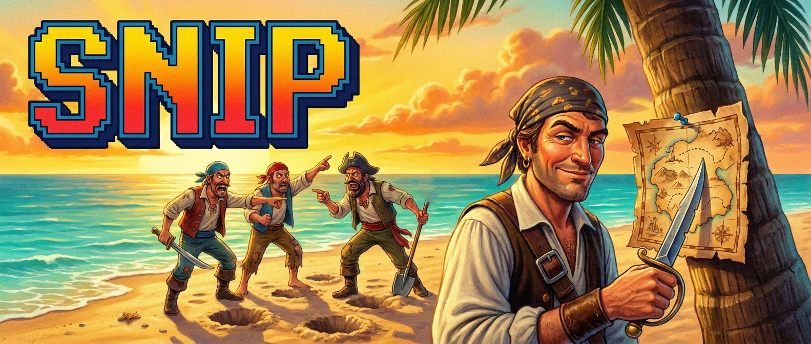
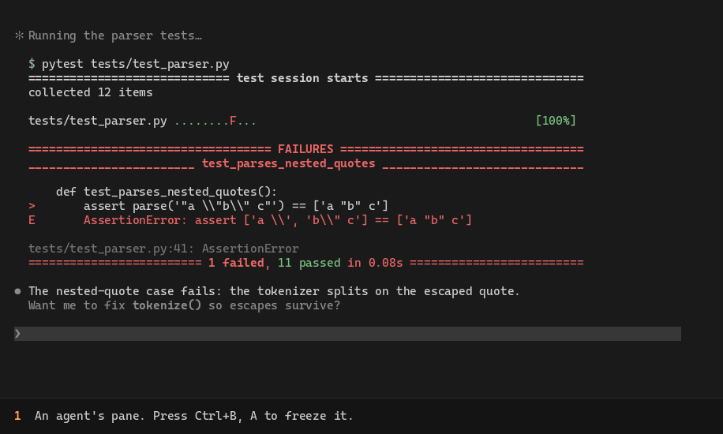

<h1 align="center"></h1>

<p align="center">Freeze a <a href="https://herdr.dev">Herdr</a> pane, box part of it with two clicks, and ask any agent about it.</p>

<p align="center">
  <a href="https://github.com/eStudio37/herdr-snip/actions/workflows/ci.yml"></a>
  <a href="LICENSE"></a>
</p>



[Watch the 27-second demo with sound](

https://github.com/user-attachments/assets/ecf7a634-46f1-4116-bc6b-f7d34c9eb4bc

) (MP4, 2.2 MB).

When one agent prints something another agent should look at, such as a failing test, a stack trace or a diff, copying it across panes by hand is clumsy, and the receiving agent never knows where it came from. Snip freezes the screen, lets you box exactly the part you mean, and sends it with your question to the agent you pick, with a header saying whose screen it is.

## Features

- **Two-click selection on a frozen screen.** The copy lines up cell for cell with the live pane, so nothing jumps. Inside the box the real colors come back as you move the mouse.
- **Question, then agent.** A card takes your question, then a second card lists every agent in the Herdr server with its status. Blocked agents are shown but can't be picked, and your last choice is remembered.
- **Context travels with it.** The message names you, the agent, pane, session and folder the box came from, and the box position.
- **Text, not screenshots.** The agent gets the exact characters, at a fraction of the tokens an image would cost.
- **Small touches.** A braille hit spark on each click, a hint bar that moves out of your way, and optional 8-bit sound effects.
- **No dependencies.** Python 3.9+ standard library only.

## Requirements

- Herdr 0.9.3 or later, with mouse capture on (the default).
- Python 3.9 or later, available as `python3`.
- Linux. Tested on Ubuntu 24.04 under WSL2. macOS should work and the test suite runs there in CI, but it hasn't been tried with a live Herdr yet. Native Windows Herdr is not supported.
- Sound effects need WSL. Everywhere else the plugin runs silently.

## Install

```sh
herdr plugin install eStudio37/herdr-snip
```

Then bind a key in `~/.config/herdr/config.toml`:

```toml
[[keys.command]]
key = "prefix+a"
type = "plugin_action"
command = "estudio37.snip.open"
description = "snip part of this pane"
```

and reload Herdr's config:

```sh
herdr server reload-config
```

Any free key works. `prefix+a` is free in Herdr's defaults, but other plugins sometimes suggest it too.

To work on the plugin itself, clone the repository and link it instead:

```sh
git clone https://github.com/eStudio37/herdr-snip
herdr plugin link "$PWD/herdr-snip"
```

## Use

Press your key in the pane you want to snip. The pane freezes and a hint bar shows what to do next.

| Step | Mouse | Keys |
|---|---|---|
| Box | Click the top-left corner, then the bottom-right | `r` starts over, `Esc` closes |
| Question | Type in the field, click **Continue** | `Enter` continues, `Ctrl+U` clears, `Esc` goes back |
| Agent | Click an agent, then **Send** | `↑` `↓` or `j` `k` to choose, `Enter` sends, `Esc` goes back |

The question is optional. Snip closes on its own after 15 minutes without input.

## What the agent receives

````text
Ada (the operator) boxed part of agent tess's screen and is asking:
Why does this test fail?

Source agent: tess (claude), pane w1:p1
Session: Fix the quote parser
Directory: /home/dev/parser
Box: rows 13-17, columns 3-67
```
    def test_parses_nested_quotes():
>       assert parse('"a \\"b\\" c"') == ['a "b" c']
E       AssertionError: assert ['a \\', 'b\\" c'] == ['a "b" c']

tests/test_parser.py:41: AssertionError
```
````

When you send a box back to the agent it came from, the first line says "your own screen" instead.

## Settings

Settings live in a file named `config` in the plugin's config folder:

```sh
herdr plugin config-dir estudio37.snip
```

```ini
# one "key = value" per line; "#" starts a comment
operator = Ada      # your name in the message header; leave it out for "The operator"
sound = on          # on or off
volume = 0.5        # 0.0 to 1.0
```

`operator` and `sound` take effect on the next snip. `volume` applies the next time the sound player starts: it quits after 10 idle minutes, or end it now with `pkill -f 'snip-sound serve'`.

## How it works

1. Your key runs `bin/snip-open`. It saves the pane's visible screen with `herdr pane read --format ansi`, records which agent is in the pane and where the pane sits in its tab, then opens `bin/snip` as an overlay.
2. `bin/snip` draws the saved screen frozen, under Herdr's one-cell overlay frame, so every character stays where it was. It reads the mouse itself, which Herdr forwards to overlay panes.
3. **Send** runs `herdr agent prompt <agent> <message>`.

Nothing leaves your machine except through the agent you send to. Runtime files live in `~/.local/state/herdr-snip` (or `$XDG_STATE_HOME/herdr-snip`): the last frozen screen, `result.json` describing the last snip, and the sound log.

### Sound

On WSL, Linux audio usually isn't available, so `bin/snip-sound` synthesizes the effects in Python and hands them to one long-lived Windows PowerShell process. That process mixes them into an audio stream it keeps open, which is what lets fast typing and cursor ticks overlap without cutting each other off. Windows won't idle-sleep while an audio stream is open, so the player quits after 10 minutes without a sound.

## Troubleshooting

- **The key does nothing.** Check `herdr plugin list` shows `estudio37.snip` as enabled, and that the key binding's `command` is `estudio37.snip.open`.
- **Clicks aren't picked up.** Herdr must capture the mouse: `ui.mouse_capture` must not be set to `false` in Herdr's config.
- **The frozen screen is offset from the live one.** Please open an issue and include `~/.local/state/herdr-snip/result.json`. Its `overlay` entry shows the sizes Snip worked from.
- **Sending fails.** The card shows Herdr's reason. An agent waiting on an approval prompt can't receive a message until you answer it.
- **No sound.** Sound needs WSL. `~/.local/state/herdr-snip/sound.log` shows what the player reported.

## Development

```sh
python3 -m unittest discover -s tests -v
```

The tests run the real picker in a pseudo-terminal, send it the same escape sequences a terminal sends for clicks and keys, and stand in for Herdr with `tests/fake-herdr`. See [CONTRIBUTING.md](CONTRIBUTING.md).

## License

[MIT](LICENSE)
